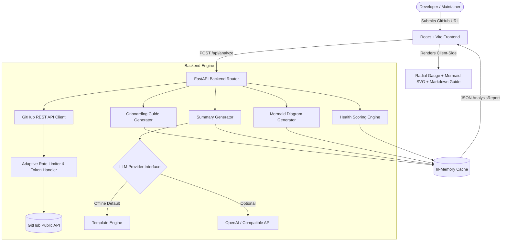

<div align="center">

# 🔍 RepoLens

**Instant architecture diagrams, plain-English summaries, contributor onboarding guides, and health scores for any GitHub repository.**

[](https://github.com/yashwantraj147-eng/repolens/actions)
[](https://github.com/yashwantraj147-eng/repolens)
[](https://www.python.org/)
[](https://fastapi.tiangolo.com/)
[](https://react.dev/)
[](https://tailwindcss.com/)
[](LICENSE)

[Features](#-key-features) • [Architecture](#-architecture) • [Scoring Rubric](#-7-point-health-score-rubric) • [Quick Start](#-quick-start) • [Docker](#-docker--compose) • [API Docs](#-api-reference) • [Roadmap](#-roadmap)

---

</div>

## 💡 What is RepoLens?

Exploring unfamiliar open-source projects or auditing prospective repositories is often slow and manual. Developers spend hours clicking through nested directories, parsing `README` files, and inspecting commit graphs just to answer three questions:

1. *What does this project actually do?*
2. *How is it structured architecturally?*
3. *How healthy, maintained, and contributor-friendly is it?*

**RepoLens** automates this entirely. Provide any public GitHub repository URL, and within seconds receive a comprehensive, visual report page.

---

## ✨ Key Features

- **📖 Plain-English Intelligence Summary**: Synthesizes the project's purpose, technology stack, and real-world utility using intelligent metadata extractors (pluggable with LLMs such as OpenAI or offline rule-based templates).
- **📐 Auto-Generated Architecture Diagram**: Emits an interactive [Mermaid.js](https://mermaid.js.org/) graph visualizing entry points, services, routes, utilities, and infrastructure without requiring diagram configuration.
- **🚀 Contributor Onboarding Guide**: Formats language-specific terminal setup steps, dependency installation, testing commands, and git branch workflows so new developers can contribute on day one.
- **🛡️ 7-Point Health Score (0–100)**: Evaluates README completeness, commit rhythm, issue response velocity, test infrastructure, licensing, documentation, and CI/CD pipelines.
- **🔗 Shareable Report Pages**: Ephemeral URL parameters (`?report_id=...`) and instant one-click sharing for engineering team reviews.
- **🌓 Modern, Accessible UI**: Built with React, Tailwind CSS, Lucide icons, responsive layout, and dark/light mode toggle.

---

## 🏗️ Architecture



### Clean Architecture Separation
- **`app/routers/`**: HTTP endpoints, input validation, and HTTP error mapping.
- **`app/services/`**: Pure business logic (GitHub client, scoring engine, diagram builder, summary generator).
- **`app/services/llm/`**: Pluggable provider interface (`LLMProvider`) enabling local heuristic templates by default or external LLMs when configured.
- **`app/models/`**: Strongly-typed Pydantic schemas and Enums ensuring robust type safety.
- **`app/utils/`**: URL regex validators and GitHub API rate-limit backoff handler.

---

## 📊 7-Point Health Score Rubric

Every repository is scored from **0 to 100** across seven weighted categories:

| Category | Weight | Evaluation Criteria |
| :--- | :---: | :--- |
| **README Quality** | **20%** | Length (500+ chars), section headings, code blocks, build/coverage badges, installation commands, visual media (screenshots/GIFs). |
| **Test Presence** | **20%** | Dedicated test directories (`tests/`, `spec/`), unit test files, runner configs (`pytest.ini`, `jest.config.*`), and coverage configs. |
| **Commit Activity** | **15%** | Commit frequency over the last 90 days with a recency bonus for commits within the last 7 days. |
| **Documentation** | **15%** | Presence of `docs/` folder, `CONTRIBUTING.md`, `CODE_OF_CONDUCT.md`, `CHANGELOG.md`, and enabled GitHub Wiki. |
| **Issue Response Time** | **10%** | Median resolution and response time on closed issues (1 day = 100 pts, <3 days = 80 pts, <7 days = 60 pts). |
| **License** | **10%** | Valid SPDX identifier (100 pts) or recognized LICENSE file (80 pts). Unlicensed code receives 0 pts. |
| **CI/CD Setup** | **10%** | Active CI workflows: GitHub Actions (`.github/workflows`), Travis CI, CircleCI, Jenkinsfile, GitLab CI, Azure Pipelines. |

Letter grades follow standard academic boundaries: **A+ (95+)**, **A (90–94)**, **B (75–84)**, **C (60–74)**, **D (50–59)**, and **F (<50)**.

---

## 🚀 Quick Start

### Prerequisites
- Python 3.11+
- Node.js 20+ & npm

### 1. Clone & Setup Backend
```bash
# Clone the repository
git clone https://github.com/yashwantraj147-eng/repolens.git
cd repolens/backend

# Create and activate virtual environment
python -m venv venv
# Windows:
venv\Scripts\activate
# macOS/Linux:
source venv/bin/activate

# Install dependencies
pip install -r requirements-dev.txt

# Create environment file (optional for token/rate limits)
cp .env.example .env

# Run FastAPI backend
uvicorn app.main:app --reload --port 8000
```
Backend is now running at `http://localhost:8000`.  
Interactive API docs are live at `http://localhost:8000/api/docs`.

### 2. Setup Frontend
```bash
cd ../frontend

# Install dependencies
npm install

# Start Vite dev server
npm run dev
```
Open `http://localhost:5173` in your browser.

---

## 🐳 Docker & Compose

Run the complete multi-container stack with a single command:

```bash
docker compose up --build
```

- **Frontend**: Available at `http://localhost:3000` (Nginx reverse proxy)
- **Backend API**: Available at `http://localhost:8000`

---

## 🔌 API Reference

### Health Check
```http
GET /api/health
```
**Response:**
```json
{
  "status": "healthy",
  "service": "RepoLens",
  "version": "1.0.0"
}
```

### Analyze Repository
```http
POST /api/analyze
Content-Type: application/json

{
  "repo_url": "https://github.com/fastapi/fastapi"
}
```

**Response (Sample truncated):**
```json
{
  "report_id": "9b1deb4d-3b7d-4bad-9bdd-2b0d7b3dcb6d",
  "repo": {
    "owner": "fastapi",
    "name": "fastapi",
    "url": "https://github.com/fastapi/fastapi",
    "description": "FastAPI framework, high performance, easy to learn, fast to code, ready for production",
    "language": "Python",
    "stars": 75000,
    "forks": 6200,
    "open_issues": 350,
    "license_name": "MIT"
  },
  "summary": "fastapi/fastapi is a modern, high-performance web framework for building APIs...",
  "architecture_diagram": "graph TD\n    ROOT[\"fastapi<br/>Python fullstack\"]...",
  "onboarding_guide": "## Getting Started with fastapi/fastapi\n...",
  "health_score": {
    "overall": 92,
    "grade": "A",
    "breakdown": {
      "readme_quality": { "score": 95, "weight": 0.2, "details": "Good length; Has badges; Install guide found" },
      "test_presence": { "score": 100, "weight": 0.2, "details": "Test directory found: tests; Comprehensive test files" },
      "commit_activity": { "score": 90, "weight": 0.15, "details": "50+ commits in the last 90 days" }
    }
  },
  "generated_at": "2026-10-30T01:00:00Z"
}
```

### Retrieve Report
```http
GET /api/reports/{report_id}
```

---

## 🧪 Testing

### Backend (100% Scoring Engine Coverage)
```bash
cd backend
pytest tests/ --cov=app.services.scoring_engine --cov-report=term-missing
```

### Frontend Unit Tests
```bash
cd frontend
npm run test
```

---

## 🛠️ Environment Configuration

| Variable | Default | Purpose |
| :--- | :---: | :--- |
| `GITHUB_TOKEN` | `None` | Personal Access Token to raise GitHub rate limit from 60 to 5,000 req/hr. |
| `OPENAI_API_KEY` | `None` | Optional API key to activate OpenAI LLM summaries. |
| `OPENAI_BASE_URL` | `https://api.openai.com/v1` | Custom endpoint for local LLMs (e.g., Ollama or vLLM). |
| `LLM_MODEL` | `gpt-3.5-turbo` | LLM model identifier. |
| `BACKEND_PORT` | `8000` | Port for the backend service. |
| `CORS_ORIGINS` | `*` | Allowed CORS origins (comma-separated). |
| `CACHE_TTL_SECONDS` | `3600` | Expiration time for cached reports. |

---

## 🗺️ Roadmap & Extensions

- [ ] **Dependency Security Vulnerability Audit**: Integration with OSV/GitHub Advisory database.
- [ ] **Interactive PR Impact Simulator**: Show how adding tests or a license impacts the repo's grade.
- [ ] **PDF & Markdown Report Export**: Downloadable one-page executive summary for diligence.
- [ ] **Ollama / Local LLM Direct Integration**: One-click local inference using embedded llama-cpp.
- [ ] **Multi-Repo Comparative Benchmarking**: Compare two competing libraries side-by-side.

---

## 📄 License

Distributed under the [MIT License](LICENSE).

